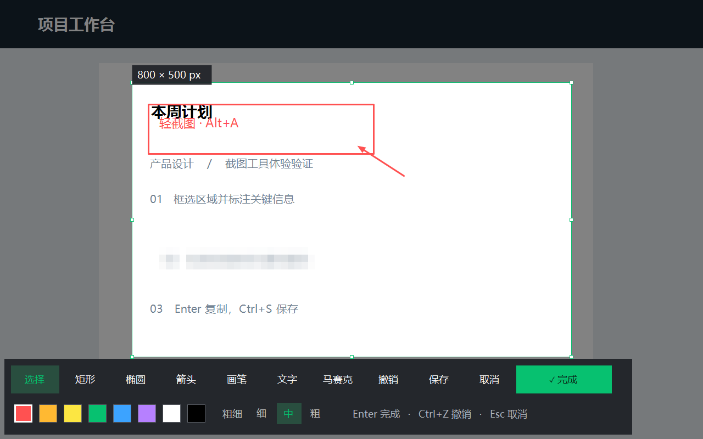

# 轻截图

独立 Windows 截图工具，使用微信 Windows 版常用的 **Alt+A** 全局快捷键。C# / WinForms 实现，没有第三方应用依赖，截图只在本机处理。

## 使用

从 [GitHub Releases](https://github.com/StephenTeak/QingShot/releases/latest) 下载便携 ZIP，解压后双击 `QingShot.exe`；也可直接下载单文件 EXE。无需安装 .NET，适用于 Windows 10/11 x64。

程序常驻系统托盘。按 **Alt+A** 或双击绿色托盘图标开始截图。右键托盘图标可重新注册快捷键、查看帮助或退出。

截图开始后，悬停到窗口上自动识别并高亮窗口边框，单击选中整个窗口；拖动鼠标仍可自由框选。选中后使用边框上的控制点调整大小；选择“选择”工具可移动选区。支持矩形、椭圆、箭头、画笔、文字和区域马赛克，可选择颜色及粗细。

窗口识别按前后顺序选择鼠标下的可见顶层窗口，跳过最小化、隐藏窗口和桌面/任务栏，优先使用 DWM 的可见边框。截图截取当前冻结桌面中的窗口矩形，遮挡内容不会自动恢复，超出屏幕部分不会截入；不识别窗口内的子控件。

| 操作 | 快捷键 |
| --- | --- |
| 开始截图（全局） | Alt+A |
| 复制图片并完成 | Enter / Ctrl+C |
| 复制图片并完成（选择工具） | 双击选区 |
| 保存 PNG 并完成 | Ctrl+S |
| 撤销上一条标注 | Ctrl+Z |
| 取消截图 | Esc / 鼠标右键 |
| 确认正在输入的文字 | Enter |
| 文字换行 | Shift+Enter |
| 放弃正在输入的文字 | Esc |

输入文字时，Ctrl+C、Ctrl+Z 保留文本框原有行为。保存对话框取消后可继续编辑，保存失败会保留截图。

**开机启动：** 右键托盘图标，勾选“开机启动（当前用户）”，下次登录 Windows 时自动运行；再次点击取消。默认关闭，无需管理员权限。程序应放在固定目录，移动或升级后请重新取消并勾选以更新路径。若在 Windows 设置中禁用了此启动项，需在那里重新启用。

**快捷键冲突：** Alt+A 注册被微信或其他软件占用时，托盘气泡会提示并启用轻截图优先处理。低级键盘钩子拦截 Alt+A，阻止普通全局快捷键收到此按键；不会改动微信设置。退出轻截图即释放拦截。若其他软件后来安装的键盘钩子抢先处理，可从轻截图托盘菜单选择“重新注册 Alt+A”。Windows 没有绝对快捷键优先级，此行为无法保证覆盖所有其他钩子、安全桌面或高权限窗口。拦截仅处理 Alt+A，不记录键盘输入。



## 开发与构建

Windows 10/11 x64，开发需要 .NET 9 SDK。

```powershell
dotnet build -c Release
dotnet run -c Release -- --capture
dotnet run -c Release -- --self-test
Get-Content bin/Release/net9.0-windows/self-test.txt
```

自检覆盖反向框选、边界限制、裁剪像素、标注坐标、马赛克、PNG 保存/覆盖、负坐标屏幕原点、框选/移动/调整/撤销/文字交互处理，以及原生热键注册/冲突/重试/释放。`verification/` 中生成合成桌面的编辑界面和导出预览，不读取用户屏幕。

生成包含运行时的便携单文件 EXE（目标电脑无需安装 .NET）：

```powershell
dotnet publish -c Release -r win-x64 --self-contained true -o dist -p:PublishSingleFile=true -p:IncludeNativeLibrariesForSelfExtract=true -p:EnableCompressionInSingleFile=true -p:DebugType=None -p:DebugSymbols=false
```

## 实现范围

- 冻结整个虚拟桌面后框选，支持跨显示器选区；采用 Per-Monitor V2 DPI 感知和物理像素坐标。
- 标注跟随桌面内容坐标，移动选区改变裁剪范围。
- 导出的图片不含遮罩、边框或工具栏；复制后的图片可直接粘贴到聊天或文档中。
- 不包含 OCR、滚动长截图或录屏。
- 受系统保护的窗口、DRM 视频和安全桌面可能无法捕获。

源文件：`Program.cs`（托盘和热键）、`CaptureForm.cs`（截图编辑界面）、`Annotation.cs`（标注和裁剪）、`SelfTest.cs`（自检）。

## 当前验证结果

2026-10-13：Release 编译通过（0 警告、0 错误），便携 EXE 自检通过，包括 Win32 Alt+A 注册、快捷键占用检测和释放。已检查合成桌面的工具栏/导出图片渲染。

当前环境的 Windows 界面控制组件无法连接，因此尚未完成真实鼠标键盘操作、剪贴板粘贴和多显示器混合 DPI 的端到端实操验证。交互自检直接调用程序的鼠标/键盘处理方法；剪贴板自检检查图片数据格式。
